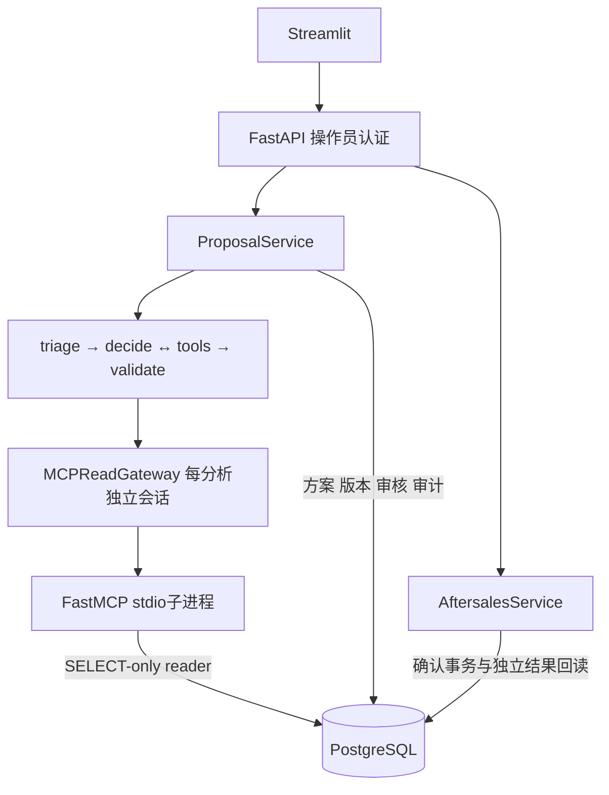

# 系统架构

PostgreSQL是唯一业务事实源。MCP只承载Agent读取，方案与审核由ProposalService保存，工单写入只由FastAPI内部AftersalesService执行。

## 分层边界

| 层 | 职责 |
| --- | --- |
| 页面 | 请求与工单；未保存修改不能确认；重新渲染只读取 |
| Agent | 结构化分析；最多3轮工具、6次读尝试、7次模型调用 |
| MCP | 三个读工具；只拿reader配置，不继承模型、写库或操作员凭据 |
| 领域规则 | 签收窗口、整数分金额、明确eligible/ineligible/unknown |
| 确认服务 | 锁方案→订单→共享政策锁，重读事实、资格与有效期 |
| 数据库 | 五表、外键、CHECK、当前版本与有效工单部分唯一索引 |

分析会保存问题、方案和审计，“分析零工单”不等于数据库完全没有写入。缺信息与系统超时是不同结果。草稿修改产生新版本，旧批准不授权新内容；hash绑定内容，不替代身份认证。

## 确认与未知结果

一次确认将本次审批、审批审计、requested工单、executed和成功审计同事务提交。flush不等于commit，失败回滚本次业务变更；旧批准执行接口保留兼容。同方案重放原工单，不同方案同订单竞争不得伪装本次成功。

响应丢失或回读失败进入待核验，保留原方案，只查询execution与独立ticket结果，一致才显示成功。请求刷新不靠页面内存判断。归档不能绕过旧写入口，也不取消已有工单。

## 状态与查询

请求由当前Proposal汇总，无第六张requests业务表。列表在数据库筛选与游标分页，不加载完整payload或逐条扫审计；详情与提交仍严格核验。管理token独立于审批hash，批量整理最多50条，整批原子。

时间存储比较归一UTC，SystemClock读取本机带时区当前时间，页面转本机显示，测试注入FixedClock。演示采用2026年10月9日固定时刻，不能与运行时“今天”混为一谈。

## 本地与容器

正常本机入口run.py检查原业务配置；独立演示入口demo_local拥有自己的PG库、角色、端口和进程记录。二者不覆盖配置、不共享业务数据。

Compose定义db/api/ui三个服务，MCP是api内部子进程，没有独立网络端口。镜像、角色与依赖配置已实现，完整容器启动和数据卷重启仍待实际引擎验证。当前没有公网部署、多人权限、生产容量、资金执行或长期记忆系统。
