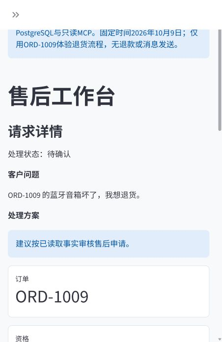
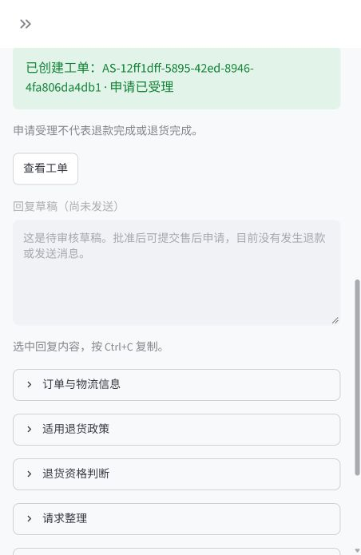
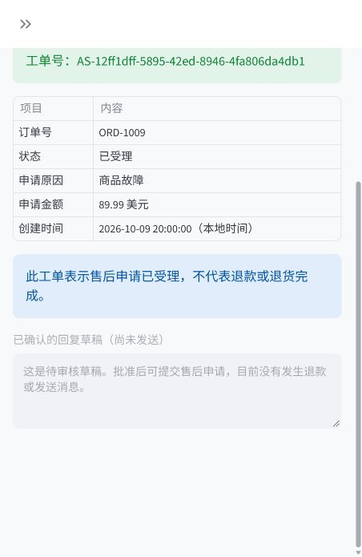
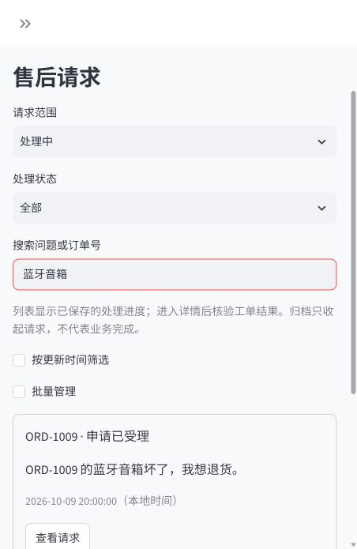

# 两分钟本机演示

这是一套合成数据、FakeLLM固定脚本、固定Clock、真实PostgreSQL及只读MCP演示，没有在线服务器，也不测模型语言理解。

1. 按[本地运行](local_run.md)启动独立演示，浏览器进入18701端口。页面显示演示模式标记。
2. 点击新建请求，输入“音箱坏了，我想退货。”，开始分析，应显示待补充订单号，没有新工单。
3. 补充栏选中原有文字后替换为“订单号是ORD-1009，音箱坏了，我想退货。”，点击补充并分析。应显示待确认、89.99美元、商品故障和政策依据。
4. 查看回复草稿尚未发送，确认金额与证据后点击“确认并创建工单”。后端提交并独立回读一致后显示申请已受理。
5. 点击查看工单，核对订单、金额和状态。强调这里只创建申请，没有退款和消息发送。
6. 返回请求列表，用商品或订单搜索，展示历史按需加载与归档入口。

同订单已有有效工单时不能再创建新的申请。需要重走流程时，先停止，显式reset，再启动；只会清除本入口拥有的showcase演示库，不处理现有业务库。停止不自动重置。

## 当前截图

截图是实际浏览器的窄视口，不是静态UI稿，也不是线上部署证明。

