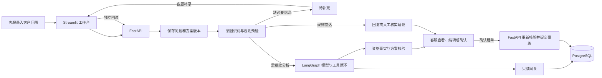

# AftercarePilot V1.0 只读审计报告

**V1.0 已实现一条可演示的客服工作流：客服录入问题，系统补齐必要信息、查询业务事实并生成建议，客服确认后创建内部售后工单。** 适合 AI 产品经理求职展示的部分，是这条流程如何分配判断权：AI 理解问题和拟稿，业务代码判断退货资格，客服决定是否提交，系统核验提交结果。当前证据主要覆盖系统行为和合成场景，真实客服的使用效率与体验仍待验证。

本次审计基于本地 `main` 的 `1b0276b`，以上游 `3d38d5a` 为对照。审计前后工作区均干净。以下结论来自源码、Git 历史和已有运行记录。本次未启动业务服务、写入数据库、调用模型或修改文件。

## A. 系统架构和业务流程

### 目录与实际入口

| 层次 | 当前职责 |
|---|---|
| `src/ui` | Streamlit 工作台、API 客户端、中文状态与错误映射、请求管理组件。 |
| `src/api`、`src/main.py` | FastAPI 路由、请求校验、操作员身份、服务依赖和就绪检查。启动时检查数据库并处理遗留的中断分析。 |
| `src/agent` | LangGraph 条件路由、意图与实体提取、模型调用、工具循环、结构化方案和证据核验。 |
| `src/tools`、`src/mcp` | 三个业务读工具的网关。代码默认走 MCP stdio 子进程，配置支持 DirectReadGateway。 |
| `src/services`、`src/domain` | 请求与方案管理、资格规则、确认事务、状态映射、金额、时间与版本校验。 |
| `src/storage`、`alembic` | SQLAlchemy 模型、查询和迁移。PostgreSQL 是业务事实源。 |
| `scripts`、`tests`、`src/evaluation`、`evaluation` | 启动、演示、验证、工程测试、评测数据和报告。`docs` 保存运行说明、架构、截图和来源说明。 |

实际运行有三条入口：

- **本机工作台**：`run.py` 启动 `src.main:app` 和 `src/ui/streamlit_app.py`。该入口绑定 `127.0.0.1`，端口分别为 `8000`、`8501`。数据库与操作员需按文档准备。 [本机启动脚本](../run.py#L56) · [本地运行说明](../docs/local_run.md)
- **面试隔离演示**：`python -m scripts.demo_local start --open`，使用独立 PG 库和角色、固定 Clock、FakeLLM 与真实只读 MCP，默认端口 `18700/18701`。演示模型是固定流程脚本，文档指定用合成订单 `ORD-1009` 走退货流程。 [演示入口](../scripts/demo_local.py) · [演示说明](../docs/demo.md)
- **容器入口**：`compose.yaml` 定义 DB、API、UI，`scripts/start_api.py` 承担显式初始化及启动。已有配置和本机验证记录，完整 Compose 启动、数据卷重启及公网部署未验收。 [Compose 配置](../compose.yaml) · [容器启动脚本](../scripts/start_api.py#L75) · [验收记录](../docs/repository_readiness.md)

五张业务表是 `orders`、`return_policies`、`proposals`、`aftersales_tickets`、`audit_logs`。请求列表按同一 `request_id` 的当前 Proposal 汇总，历史版本保留在同表中。MCP 读取使用 reader 权限，审批和建单走 FastAPI 的服务层。 [数据模型](../src/storage/models.py#L14) · [请求查询](../src/services/request_service.py#L38) · [网关选择](../src/tools/factory.py#L8)

### 从客户问题到售后工单

| 环节 | 输入 → 输出 | 执行主体 | 异常与分支 |
|---|---|---|---|
| 1. 录入并开始分析 | 客服录入的原话、可选既有请求编号 → 保存当前分析版本和分析开始记录。界面中尚未提交的输入留在页面。 | 人工录入，API 和服务代码保存 | 空输入有页面提示。认证、归档、并发分析或版本冲突由后端拦截。 [录入页面](../src/ui/streamlit_app.py#L136) · [分析服务](../src/services/proposal_service.py#L29) |
| 2. 意图与实体识别 | 客户问题和同一请求的历史上下文 → 意图、订单号、原因、语言、缺失字段。覆盖订单查询、物流查询、退货申请、政策咨询、一般问题和超范围。 | 确定性预检与 LLM，部分场景由规则直达 | 结构化输出需校验，允许受限纠正。模型超时、结构仍无效或预算耗尽可结束分析并记录失败。 [识别节点](../src/agent/nodes.py#L83) · [意图结构](../src/domain/proposals.py#L28) |
| 3. 追问与补录 | 缺订单号、存在多个候选订单或缺退货原因 → `clarification` 和补充提示。客服提交补充内容后沿同一请求生成新版。 | 代码决定缺失项，人工补录 | 能确定缺订单号的请求走“待补充”。真正的模型或查询异常走失败分支。当前是工作台内补录。 [预检与追问](../src/agent/nodes.py#L131) · [补充入口](../src/ui/streamlit_app.py#L276) |
| 4. 查询业务事实 | 订单号、政策标识、原因 → `get_order`、`get_return_policy`、`check_return_eligibility` 的结构化返回及证据记录。 | LLM 请求工具，代码校验参数、执行白名单调用并将结果写回消息循环 | 未知工具、参数不匹配、超时或读取预算耗尽有错误分支。校验阶段可在预算内补读必要证据。 [图路由](../src/agent/graph.py#L6) · [工具循环](../src/agent/nodes.py#L247) · [MCP 服务](../src/mcp/server.py) |
| 5. 判断退货资格 | 订单、适用政策、有效工单、申请原因与 Clock → `eligible`、`ineligible` 或 `unknown`，附原因码、截止时间、整单金额和币种。 | 确定性业务规则 | 未签收、取消、超期、原因不适用或已有有效申请可判不符合。签收时间缺失或异常、政策缺失或规则异常可判未知。截止时刻包含在窗口内。缺原因时的基础资格不能授权建单。 [资格服务](../src/services/eligibility_service.py#L8) · [退货规则](../src/domain/policy.py#L13) |
| 6. 生成并保存方案 | 意图和事实证据 → 退货方案、仅回复、待补充或需人工核实，连同摘要、草稿、证据、版本和 hash 保存。 | LLM 拟稿或规则生成，代码校验结构与证据 | 金额、期限与资格须与事实一致。缺失或矛盾证据、提前宣称已经完成等情况触发受限纠正或失败。人工核实建议停留在系统提示。 [方案校验](../src/agent/nodes.py#L318) · [证据校验](../src/agent/evidence.py#L21) · [保存结果](../src/services/proposal_service.py#L65) |
| 7. 客服审核 | 当前方案与草稿 → 保存修改、确认草稿、暂不采用，或确认并创建工单。 | 人工决定，API 记录操作员和校验版本 | 草稿未保存时禁用确认。保存生成新版，旧版本、错误 hash、过期方案或归档请求无法继续走原确认路径。仅确认回复不产生工单。 [审核页面](../src/ui/streamlit_app.py#L228) · [版本与审核服务](../src/services/proposal_service.py#L134) |
| 8. 建单与核验 | 操作员身份、方案 ID、预期版本和 hash → `requested` 工单、执行完成状态、成功审计和独立回读。 | 人工触发，FastAPI 服务执行 | 后端加锁并重读订单、政策和资格。新审批、工单、执行状态、成功审计在同一事务提交，失败回滚本次变更。同方案重复提交回读原工单，其他方案的重复申请受拦截。响应丢失或回读不一致时进入“待核验”。 [确认事务](../src/services/aftersales_service.py#L65) · [执行结果回读](../src/services/aftersales_service.py#L198) |

**两个展示口径**：分析会保存请求、方案和审计，所以“未确认零工单”指没有新增售后工单。页面的“申请已受理”指内部申请记录已创建，退款、实际寄回和退货完成是后续业务环节。

## B. 现有功能清单

| 能力 | 当前可展示的行为 |
|---|---|
| 客服受理 | 自由文本录入、查找并填入订单号、补充信息、按原请求重新分析。 |
| 售后事实读取 | 订单和模拟物流信息、适用退货政策、已有申请与退货资格。 |
| AI 建议 | 分类和实体提取、工具查询、证据留存、结构化方案、可编辑且尚未发送的回复草稿。 |
| 人工决策与执行 | 仅确认草稿、拒绝建议、合并确认建单、版本校验、并发防重、提交结果核验。 |
| 请求管理 | 状态、关键词、日期、归档范围筛选，游标分页，归档／恢复、当页批量管理、受保护的单条永久清除。 |
| 工单与审计 | 工单列表及详情、关联工单跳转、按需查看历史版本及操作记录。 |
| 本地运行管理 | 操作员令牌、健康和就绪检查、模拟演示入口、可选 Langfuse 接线。 |

### 原项目与二次开发归属

- **上游已有**：FastAPI、Streamlit、LangGraph、可选 Langfuse、订单／物流／退货示例、SQLite 和七个工具，其中包含 `initiate_return`。历史基线工具文件和目录树支持这一判断。 [上游基线工具](https://github.com/InfinityZwZ/AftercarePilot/blob/3d38d5a/src/agent/tools.py) · [本地归属说明](../docs/upstream_attribution.md)
- **二次开发新增或实质重做**：五张 PG 表和迁移、确定性退货规则、只读 MCP、结构化方案与证据、版本审核、事务建单和防重回读、请求管理、隔离演示、评测设施和展示文档。FastAPI、Streamlit、LangGraph 属于沿用的技术基础，现有审批和工作台流程是其上的项目增量。 [架构说明](../docs/architecture.md) · [归属说明](../docs/upstream_attribution.md)
- **待确认**：公开 Git 证据可区分基线与后续改动，但个人设计、编码、AI 辅助、人工审核各自的贡献比例，需要你按实际经历补充。归属文档记录基线 README 声明 MIT，基线树无独立 LICENSE，正式对外表述前宜核实授权依据。 [归属说明](../docs/upstream_attribution.md)

## C. 前端页面与交互清单

当前只有“售后请求”和“售后工单”两个主导航。订单查找、请求整理、历史和操作记录都在页面内部。

| 界面或区域 | 控件及反馈 |
|---|---|
| 全局与侧栏 | “工作区”切换、“新建请求”、“返回请求列表”。启动未就绪时有“重新连接”。操作结果显示成功、提示、警告或错误消息。 [工作台入口](../src/ui/streamlit_app.py#L24) · [侧栏](../src/ui/streamlit_app.py#L327) |
| 售后请求列表 | 请求范围“处理中／已归档／全部”、处理状态、搜索问题或订单号、可选更新时间范围、上一页／下一页。卡片显示订单、状态、问题摘要、更新时间，“查看请求”进入详情。 [列表组件](../src/ui/request_management.py#L17) |
| 列表批量管理 | 开关“批量管理”，勾选单项或“选择当前页”，提交批量归档或恢复。筛选与换页清理选择，后端整批提交或整批回滚。 [批量交互](../src/ui/request_management.py#L36) |
| 新建、补充和重分析 | 问题文本框；“开始分析”“补充信息并分析”或“重新分析”。分析时显示进度提示。折叠区“查找订单”按订单号或商品名搜索，可分页、选择订单并“选入请求”。 [订单查找与分析表单](../src/ui/streamlit_app.py#L97) |
| 请求详情 | 展示客户问题与补充记录、处理摘要、订单、资格、申请金额、原因和截止时间。证据折叠区按实际结果展示订单／物流、政策和资格。 [详情页面](../src/ui/streamlit_app.py#L166) |
| 草稿与决策 | 回复文本区标注“尚未发送”，支持手动选择复制。可编辑状态下有“保存修改”。按方案出现“确认并创建工单”或“确认草稿”，另有“暂不采用”原因表单。 [决策控件](../src/ui/streamlit_app.py#L228) |
| 提交与异常 | 待核验时显示“查询提交结果”，核验前阻止再次建单。有新建或已存在的关联工单时提供“查看工单”。已受理提示说明业务含义。 [核验交互](../src/ui/streamlit_app.py#L205) |
| 请求整理 | 折叠区提供“归档请求／恢复请求”。已归档请求可查看永久清除预览，显示问题和版本数量，选择固定清理原因并输入“永久清除”。关联工单、跨请求引用等情况由后端拒绝。 [整理组件](../src/ui/request_management.py#L96) · [管理服务](../src/services/request_management_service.py) |
| 历史版本与操作记录 | 折叠区内手动“加载历史版本”“查看此版本”“更早的版本”“加载操作记录”“更早的操作记录”。历史方案用于只读查看。 [历史与审计组件](../src/ui/request_management.py#L144) |
| 售后工单 | 列表显示工单号、订单号、状态和金额，支持分页与“查看工单”。详情展示工单字段、已确认的回复草稿及业务提示，有“返回工单列表”。 [工单页面](../src/ui/streamlit_app.py#L291) |

请求的业务状态有 **分析中、待补充、待确认、申请已受理、草稿已确认、需人工处理、方案未采用、需重新分析、分析失败、待核验**。归档是独立属性。“处理中”作为列表范围实际表示未归档，可能包含已受理或已确认的请求。列表显示已保存的进度，详情才进一步核验工单和执行记录。 [请求状态映射](../src/services/request_service.py#L16) · [详情核验](../src/services/request_service.py#L99)

## D. 已有测试数据

| 证据类别 | 实测结果及解释 |
|---|---|
| 工程回归 | 历史 **388/388**。GitHub 展示版整理后，原工作区和仅含公开文件的干净副本各 **399 通过、0 失败、0 跳过**，各有一项已知依赖弃用警告。属于历史实测，本次只读审计没有重跑。 [验收记录](../docs/repository_readiness.md) |
| 工程覆盖 | 包含资格边界、数据库约束、旧聊天入口、审批和旧版本拦截、事务故障回滚、并发防重、提交响应丢失、MCP 只读与异常、归档和清除、时间与查询、Streamlit 交互和启动保护。主要采用 FakeLLM、固定 Clock、隔离真实 PostgreSQL、真实 MCP、页面测试及故障注入。 [测试说明](../docs/testing.md) · [事务测试](../tests/test_transaction_execution.py) · [页面测试](../tests/test_streamlit_workflow.py) |
| 合成评测集 | **120 条**，开发集 40 条、测试集 80 条。离线分别 **40/40、80/80** 通过。冻结测试预期有人工审核记录，测试集后来参与修复，最终成绩属于已见回归。 [评测摘要](../evaluation/public/report.md) · [冻结审核记录](../evaluation/v1/review-approvals.json) |
| 真实模型参与的业务回归 | `test-live-closure-final-v2` 最终业务断言 **50/50**。其中 **39 条触发模型、11 条规则直达**。在适用场景中，建单核验、幂等和防重为 **28/28**，分析阶段无新增工单为 **50/50**。规则、补读和受限纠正均参与系统结果。 [评测指标与分母](../evaluation/public/metric-details.md) |
| 模型结构与提取 | 全链路结构首次通过 **38/39（97.4%）**，修复后 **39/39**。可观察的原始意图、订单号、原因提取分别 **39/39**，原始意图只覆盖 3 种标签。结构指标按场景统计。 [分项指标](../evaluation/public/metric-details.md) |
| 时延与用量 | 完整分析 P50/P95 **12.35 / 23.88 秒**，单次模型请求 P50/P95 **2.37 / 6.76 秒**。该轮共 **162 次 HTTP 请求**，输入 **168,039**、输出 **11,473 token**。公开报告未给人民币成本。 [机器可读指标](../evaluation/public/metrics.json) |
| 人工回复审核 | 历史选用的 **48 条原回复＋2 条修复回复**已获人工认可，采用事实、政策、下一步和中文可用性四维标准。最终新生成的整批回复是 **0/50 已评分**。 [人工审核口径](../evaluation/public/report.md) |
| 真实用户验证 | 可见证据包含项目方手工试用、隔离浏览器演示和评测审核。未发现目标客服团队试用、真实客户反馈、客服对照实验、处理时长节省、满意度或生产 SLA 的测量记录。 [演示验收](../docs/repository_readiness.md) |

评测记录还保留了模型超时、缺政策证据、配送延迟被判成缺原因、提前宣称受理等失败与修复。案例展示可选一条说明如何发现问题、如何调整规则或模型约束、如何回归验证。公开工件的 `acceptance_passed` 为 `false`，其范围包含完整验收条件。**50/50 应表述为该轮业务回归通过。** [失败归因](../evaluation/public/report.md) · [验收字段](../evaluation/public/metrics.json)

## E. 产品能力缺口

以下体验问题是从界面与流程推导出的**待验证假设**。

| 观察到的现状 | 潜在体验或业务影响 | V1.1 案例中可验证的内容 |
|---|---|---|
| “处理中”代表未归档，可包含已受理条目。 | 客服可能误以为这是只包含待处理任务的队列。 | 让试用者从混合状态列表找出下一项待办，记录误选和对标签的解释。 |
| 待补充通过通用文本框录入，订单选择在折叠区，多订单时界面提示可能退化成“相关信息”。 | 客服可能不知道此时只需要选定一笔订单，增加重复输入或选错单。 | 用缺订单号和多订单两个任务验证能否一次补齐，并记录是否主动找到订单选择器。 [补充提示实现](../src/ui/streamlit_app.py#L276) |
| 工单确认与草稿确认含义不同，均涉及人工判断；政策和事实在折叠区。 | 客服可能跳过关键依据，也可能混淆“确认草稿”“内部受理”和“退款完成”。 | 在点击前请用户复述将发生什么，观察其能否找到金额、政策依据和当前工单进度。 |
| 分析有同步等待，历史评测 P95 为 23.88 秒。 | 等待期间可能缺乏可预期反馈，异常时也可能误认为要重新发起。 | 观察等待、分析失败、提交待核验三种情况下，用户是否选择正确的下一步。 |
| 需人工处理只提供结论和重新分析入口。 | 需要接手的场景缺少负责人、待办流转和跟进反馈。 | 案例明确说明人工核实发生在哪个工作环节，验证操作者能否据提示说出接手动作。 |
| 工单目前提供创建、查阅和核验。 | 客服不能在工作台内完成退款、换货、补发、物流面单或客户消息发送，也没有完整工单处置流转。 | 把 V1.1 展示目标限定在客服受理和工单创建，明确记录进入后续系统的业务交接点。 [业务边界](../docs/upstream_attribution.md) |
| 当前是本地单人令牌工作台。 | 多客服协作所需的角色权限、队列分配、租户隔离和审计权限暂无验收；真实订单和政策系统也未接入。 | 用角色图标出当前操作者及生产环境的候选角色，把实际接入与权限列为后续约束。 [系统边界](../docs/architecture.md) |

V1.1 最适合围绕**客服能否看懂建议、选择正确下一步并核实结果**收集证据。保留现有工程与模型评测，再补观察式任务记录，能直接支撑这份案例的产品判断。

## F. 需要你人工核实的事项

1. **产品使用者与场景**。确认案例是否定位在“客服专员处理电商整单退货”。核实实际业务中由谁审核、何时告知客户，以及内部工单建成后的下一环节。
2. **规则的业务依据**。请有售后经验的人核对整单范围、退货原因、签收窗口、异常订单和已有工单处理。当前规则可验证系统行为，适用真实商家政策需要单独确认。
3. **工作台可用性**。请目标用户或有客服经验的人员，在隔离演示里完成“无订单号补录”“查看依据并确认”“已有申请或结果待核验”。记录能否独立完成、在哪一步求助、是否误判结果含义和任务用时。将项目方自测与外部试用分别记录。
4. **展示内容与真实运行**。面试前确认本机 PG、操作员配置和隔离演示能启动。演示按文档走固定合成场景。当前实际供应商配置、配额和端点连通性未在本次核实，公开报告里的模型信息对应历史运行。 [本地演示约定](../docs/local_run.md)
5. **质量声明**。如果要引用最新一批的回复质量，请对最终 50 条新文本补做人工评分。现有历史选用回复审核与系统业务回归均可引用，各自保留分母与适用范围。 [评分标准及批次说明](../evaluation/public/report.md)
6. **个人贡献与来源**。核实你负责的需求界定、规则取舍、手工验收、评测审核与代码工作，准备可以现场解释的例子。对外沿用上游归属，另行确认许可依据和可展示材料范围。 [上游归属](../docs/upstream_attribution.md)